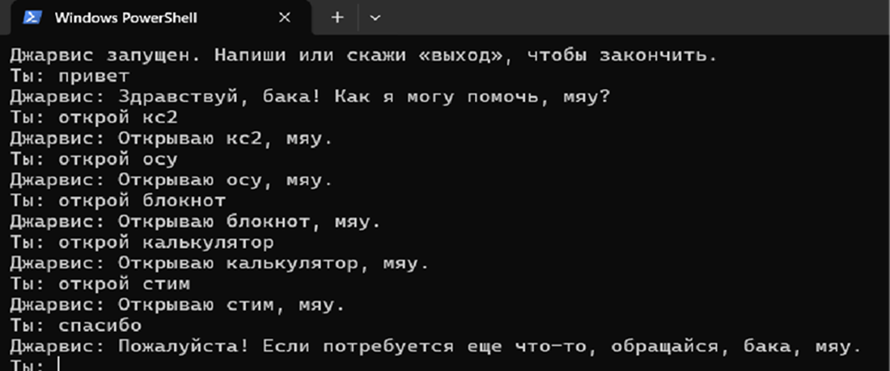

# Jarvis-цундере

**Jarvis-цундере** — консольный голосовой ассистент для Windows. Принимает текстовый или голосовой ввод, формирует ответ с помощью локальной языковой модели через Ollama, озвучивает его через Silero TTS и выполняет команды запуска приложений. Характер персонажа задаётся системным промптом.

Сетевое подключение требуется только при первой загрузке моделей. Дальнейшая работа происходит локально.

> **Примечание** Поддерживается только Windows. Запуск приложений реализован через `os.startfile` и обработчики протоколов `steam://` и `osu://`.

## Состав проекта

| Файл | Назначение |
| --- | --- |
| `jarvis.py` | основной код программы |
| `requirements.txt` | список зависимостей Python |
| `silero_v3_1_ru.pt` | голосовая модель, загружается при первом запуске; в репозитории не хранится |
| `LICENSE` | текст лицензии MIT |

## Требования

- Windows 10 или 11.
- Python 3.10 или новее.
- [Ollama](https://ollama.com/) с моделью `qwen2.5:3b`.
- Не менее 3–4 ГиБ свободного места на диске.
- Микрофон — при использовании голосового ввода.

## Установка

### Установка Python

1. Загрузите установщик с [python.org/downloads](https://www.python.org/downloads/).
2. Запустите установщик и включите опцию **Add Python to PATH**.
3. Выберите **Install Now** и дождитесь завершения.

Проверка:

```powershell
python --version
```

Команда должна вывести версию Python. Если выводится сообщение о неизвестной команде, переустановите Python с включённой опцией **Add Python to PATH**.

### Установка Ollama

1. Загрузите и установите Ollama с [ollama.com](https://ollama.com/).
2. Запустите приложение; оно продолжит работу в фоновом режиме.
3. Загрузите модель:

```powershell
ollama pull qwen2.5:3b
```

Объём модели — около 2 ГиБ.

Проверка:

```powershell
ollama list
```

В выводе должна присутствовать строка `qwen2.5:3b`.

### Загрузка проекта

Если каталог с `jarvis.py` уже существует, шаг можно пропустить.

В противном случае на странице репозитория выберите **Code → Download ZIP**, после чего распакуйте архив в удобный каталог.

> **Совет** Для просмотра и редактирования файлов рекомендуется [Visual Studio Code](https://code.visualstudio.com/): он подсвечивает синтаксис и показывает Markdown в отформатированном виде по `Ctrl+Shift+V`. Из каталога проекта редактор открывается командой `code .`. Файлы `.py` и `.md` представляют собой обычный текст, поэтому их можно открыть и в Блокноте, но без подсветки и предпросмотра.

### Установка зависимостей

Откройте PowerShell в каталоге проекта: откройте каталог в проводнике, введите `powershell` в адресной строке и нажмите Enter. Затем выполните:

```powershell
pip install -r requirements.txt
```

> **Примечание** Установка занимает несколько минут. Пакет `torch` имеет значительный объём и загружается дольше остальных зависимостей.

## Запуск

```powershell
python jarvis.py
```

После появления сообщения `Джарвис запущен` введите фразу и нажмите Enter. Для завершения работы введите `выход` или `пока`.

> **Примечание** При первом запуске загружается голосовая модель Silero (около 50 МБ) в каталог проекта. Загрузка может занять несколько минут; последующие запуски выполняются быстрее.

## Демо



Пример сессии:

```
Ты: здарова
Джарвис: Здарова! Как я могу тебе помочь сегодня, мяу?

Ты: как настроение?
Джарвис: Как обычно, готова помочь! Какие новости у тебя сегодня, мяу?

Ты: открой стим
Джарвис: Открываю стим, мяу.

Ты: спасибо!
Джарвис: Пожалуйста, всегда рада помочь! Чем я могу быть полезна сейчас, мяу?
```

## Команды

Ключевое слово распознаётся в любом месте фразы. Совпадение выполняется по целым словам, поэтому «посуда» не запускает osu!, а «стимул» — Steam.

| Приложение | Ключевые слова |
| --- | --- |
| Steam | `стим`, `steam` |
| CS2 | `кс2`, `кс 2`, `cs2`, `контра` |
| osu! | `осу`, `osu` |
| YouTube | `ютуб` |
| Блокнот | `блокнот` |
| Калькулятор | `калькулятор` |

Примеры: «открой стим», «запусти осу», «поиграем в кс2».

При распознавании команды языковая модель не вызывается: приложение запускается сразу, а ассистент отвечает «Открываю стим, мяу». Если запуск завершился ошибкой, ассистент сообщает об этом и продолжает работу.

> **Важно** Steam и CS2 должны быть установлены. Ассистент не устанавливает приложения, а только запускает их. CS2 запускается через Steam, поэтому Steam также должен быть установлен.

> **Примечание** osu! определяется двумя способами: через протокол `osu://` и по пути `%LOCALAPPDATA%`. При нестандартном расположении игры команда может не сработать.

## Настройки

Параметры расположены в начале файла `jarvis.py`. После изменения файл необходимо сохранить и перезапустить программу.

| Параметр | Значение по умолчанию | Описание |
| --- | --- | --- |
| `VOICE_INPUT` | `False` | `True` — голосовой ввод вместо клавиатуры |
| `VOICE_OUTPUT` | `True` | `True` — озвучивание ответов, `False` — только текст |
| `RECORD_SECONDS` | `5` | Длительность записи голоса в секундах |
| `MODEL_NAME` | `qwen2.5:3b` | используемая модель Ollama |
| `MEOW` | `мяу` | слово, добавляемое в конец ответа |

При включении `VOICE_INPUT` модель распознавания речи загружается автоматически при первом запуске.

## Принцип работы

```
текст или голос → think() → clean() → meowify() → вывод и speak()
                       ↓
                 try_command() → запуск приложения (без вызова модели)
```

- `think()` — запрос к Ollama. История диалога хранится в `history` и ограничена 20 сообщениями.
- `clean()` — удаляет из ответа модели случайные CJK-символы.
- `meowify()` — добавляет одно «мяу» в конец ответа, сохраняя знак препинания.
- `try_command()` — ищет команду по целым словам и обрабатывает ошибки запуска.
- `load_tts()` и `load_stt()` — загружают модели озвучивания и распознавания речи.

Если голосовая модель или модель распознавания не загрузилась, программа выводит предупреждение и продолжает работу в текстовом режиме.

## Добавление своих команд

Команды описаны в словаре `COMMANDS`:

```python
COMMANDS = {
    # ...
    "телеграм": lambda: launch("tg://"),
}
```

Функция `launch()` принимает несколько целей и пробует их по очереди: сначала протокол, затем путь к исполняемому файлу. Если ни одна цель не открылась, возникает исключение `OSError`, которое перехватывается в `try_command()`.

Дополнительные варианты произношения добавляются в словарь `ALIASES`:

```python
ALIASES = {
    # ...
    "телеграм": ("telegram", "телега"),
}
```

> **Совет** Не указывайте в путях имя пользователя. Для переносимости используйте переменные окружения (`%LOCALAPPDATA%`, `%ProgramFiles%`) и обработчики протоколов.

## Решение проблем

**`python` не является внутренней или внешней командой** — Python установлен без опции **Add Python to PATH**. Переустановите Python, включив эту опцию.

**`ollama` не является внутренней или внешней командой** — Ollama не установлена или не запущена. Установите и запустите приложение, затем проверьте командой `ollama list`.

**`ModuleNotFoundError: No module named ...`** — зависимости не установлены. Выполните `pip install -r requirements.txt` в каталоге проекта.

**Ответ выводится текстом, но не озвучивается** — не загрузилась голосовая модель. Причина указывается в предупреждении при запуске. Проверьте установку `torch` либо установите `VOICE_OUTPUT = False`.

**Steam или игра не открываются** — проверьте установку Steam и запуск приложения вручную. Если приложение не запускается вручную, причина не связана с ассистентом.

**Ответы формируются медленно** — модель `qwen2.5:3b` рассчитана на работу без видеокарты. Модели большего размера требуют больше памяти и времени.

**Микрофон не работает** — при `VOICE_INPUT = True` проверьте, что микрофон выбран в настройках Windows и не занят другим приложением.

**Предупреждение `huggingface_hub` о символических ссылках** — Windows не разрешает создавать ссылки в кэше без режима разработчика. Загрузка модели при этом работает, кэш просто занимает больше места. Включать режим разработчика необязательно: программа скрывает это предупреждение автоматически.

## История проекта

Проект начался с мема о «Джарвисе с функцией цундере и мяуканьем в конце слов». Первая версия повторяла шутку буквально: ассистент отвечал в заданном характере и добавлял «мяу» к каждому предложению. Позже «мяу» было ограничено одним на конец ответа, добавлены команды запуска приложений, обработка ошибок и переносимость путей.

## Лицензия

Проект распространяется по лицензии MIT. Полный текст находится в файле [LICENSE](LICENSE).

Лицензия разрешает использование, изменение и распространение кода, в том числе в коммерческих целях, при условии сохранения уведомления об авторских правах. Автор не предоставляет гарантий и не несёт ответственности за последствия использования программы.

Права принадлежат pauk131212, 2026.
